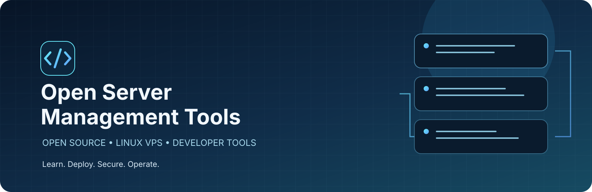

# Open Server Management Tools (OSMT)

**Learn. Deploy. Secure. Operate.**

Practical open-source tools for people who want to understand, manage, and maintain Linux VPS environments with greater confidence and control.

OSMT is an independent, early-stage open-source initiative. It aims to make everyday server operations easier to understand, safer to perform, and simpler to repeat—without hiding the underlying system or taking important decisions away from the administrator.

**Our starting point is [Xray Core Manager](#first-project-xray-core-manager). Our long-term goal is a coherent toolkit for Linux server operations.**

[Project vision](docs/PROJECT_VISION.md) · [Tools catalog](docs/TOOLS_CATALOG.md) · [Ecosystem map](docs/ECOSYSTEM_MAP.md) · [Roadmap](docs/ROADMAP.md) · [Changelog](CHANGELOG.md) · [Contributing](CONTRIBUTING.md) · [Security](SECURITY.md)

---

## The problem we want to solve

Deploying an application often means taking on another responsibility: operating the server behind it.

For students, junior developers, self-taught programmers, and independent builders, routine tasks can quickly become a steep learning curve: Linux permissions, dependencies, reverse proxies, DNS, TLS certificates, services, firewalls, backups, logs, and recovery.

Command-line tools are powerful and flexible, but a command copied without understanding can cause unexpected changes. At the other extreme, a full hosting control panel may be more than someone needs—and may hide details they are trying to learn.

OSMT is being built to bridge that gap.

## Our mission

Build a growing collection of focused, free and open-source tools that help people:

- **Learn** how Linux server components work.
- **Deploy** applications through understandable, repeatable procedures.
- **Secure** systems by identifying risks and explaining possible mitigations.
- **Operate** services with useful diagnostics, maintenance and recovery workflows.

The goal is not to automate everything or replace experienced administrators. It is to make common operations more approachable while preserving transparency, user choice, and control.

## How we approach automation

### Guided Automation

OSMT follows a simple principle: automation should make a safe procedure repeatable—not make a risky procedure easier to trigger accidentally.

Where a tool performs system changes, its intended workflow is to:

1. Explain the task, prerequisites, and possible impact.
2. Inspect the current system before proposing changes.
3. Present the planned actions and affected resources.
4. Validate inputs and configuration.
5. Request explicit approval before privileged, disruptive, or destructive actions.
6. Create a backup or recovery point when appropriate.
7. Apply changes in controlled stages.
8. Verify the outcome and report what happened.
9. Explain available recovery or undo steps.

Not every tool will need every step. Read-only inspection should remain read-only, and unsupported recovery guarantees must never be implied.

### Engineering principles

- **Understandable by design:** explain operations instead of hiding them behind opaque automation.
- **Administrator remains in control:** approval is required for consequential changes.
- **Inspect before changing:** prefer read-only discovery and previews.
- **Validate and recover:** use validation, backups, rollback, and failure handling where practical.
- **Least privilege:** request only the permissions needed for a task.
- **Honest status:** distinguish implemented, experimental, planned, and unsupported behavior.
- **Evidence over claims:** document test scope, compatibility, and limitations.
- **Technology-neutral:** choose the language and implementation suited to each tool rather than forcing the whole ecosystem into one stack.

## The ecosystem

OSMT is envisioned as a set of focused tools that can stand on their own and, where useful, work together.

| Area | Direction | Intended outcome |
|---|---|---|
| Server foundations | VPS first-run assistant, system inventory, dependency checks | Understand a server before changing it |
| Application deployment | Guided deployment, runtime setup, environment templates | Move from source code to a running service |
| Service operations | systemd assistance, log inspection, health checks | Understand and operate application services |
| Networking and domains | DNS diagnostics, reverse-proxy and TLS assistance | Configure and troubleshoot connectivity |
| Security | SSH, firewall, permissions and exposed-service reviews | Identify common risks with evidence |
| Backup and recovery | Backup, integrity checks and restore assistance | Know what is protected and how to recover |
| Monitoring and maintenance | Resource overview, service checks and update reports | Understand server health and routine maintenance |
| Learning and troubleshooting | Guided diagnostics, error explanations and validators | Learn while resolving operational problems |

These are **product directions, not released features**. Each candidate must earn its place through a clear use case, bounded scope, testing, documentation, and a maintainable implementation. See the [tools catalog](docs/TOOLS_CATALOG.md) and [roadmap](docs/ROADMAP.md).

## First project: Xray Core Manager

Xray Core Manager is the first implementation within OSMT. It is a modular, Bash-based administration tool for Xray-core on Linux.

### What is implemented in the current development baseline

- Modular command-line launcher and administration menu.
- Catalog of 38 connection modes.
- Local connection records stored as drafts.
- VLESS user records associated with draft connections.
- Neutral VLESS data model and a version-specific adapter for Xray-core 26.10.31.
- Controlled Xray binary and geodata package administration.
- Centralized filesystem paths and separated application data.
- Atomic JSON persistence and shared locking for related operations.
- Backup and guarded uninstallation workflows.
- Functional, integration, persistence-fault, and concurrency test scripts.

### Current boundaries and known limitations

Xray Core Manager is an early development version, **not a production-ready control panel**.

- Creating or editing a draft does not apply a configuration to a running Xray instance.
- It does not currently create or manage systemd units, or start/restart Xray.
- It does not modify firewall, SSH, or network settings.
- Port checks are observations and logical reservations; they do not reserve a socket against external processes.
- The VLESS adapter targets Xray-core 26.10.31.
- The uninstallation workflow still needs broader end-to-end recovery testing in an isolated environment.
- Profiles, domains, certificates, and history have planned centralized paths, but several storage consumers remain to be implemented.

The presence of test scripts does not by itself establish that every workflow has passed validation or is production-ready. See the project documentation for implementation details, contracts, and limitations.

## What we are building toward

Our first priority is to mature Xray Core Manager: complete its configuration lifecycle, improve service integration, and expand isolated installation, upgrade, failure, and recovery testing.

The next proposed project is a **VPS First-Run Assistant**: a beginner-focused, read-only utility that inventories a server's operating system, architecture, CPU, memory, storage, network, package manager, and services, then explains what it finds in a local report.

Further tools will be prioritized based on real operational needs and what can be implemented and maintained responsibly.

The roadmap is intentionally incremental. It describes direction, not a promise that every proposed tool will be delivered.

## Why this initiative matters

A useful server tool should do more than execute a command. It should help the operator understand what is happening, why a change is proposed, what could go wrong, and how to verify the result.

We believe this approach can make server administration more accessible to people learning to deploy software, while remaining useful to independent developers and experienced administrators who value focused, inspectable utilities.

OSMT is not tied to a single cloud provider, hosting company, AI platform, or vendor ecosystem. Any AI-assisted capability considered in the future should serve a clearly defined task, remain transparent to the user, and preserve administrator approval and control. AI is not a prerequisite for the project's core mission.

## Technology and development

The first component currently uses:

- Bash 5.2+
- Linux, with Ubuntu 24.04 LTS amd64 as its reference platform
- JSON for local records
- Xray-core 26.10.31 for its version-specific adapter

ShellCheck, shfmt, and shell-based tests are part of the development workflow. Future OSMT tools may use different languages and platforms where appropriate.

### Repository structure

| Path | Purpose |
|---|---|
| `bin/` | Application entry point |
| `config/` | Configuration, paths, protocol catalog, and Xray version |
| `lib/` | Shared utilities and persistence |
| `modules/` | Connections, users, Xray administration, and uninstallation |
| `docs/` | Architecture, decisions, vision, and roadmap |
| `tests/` | Functional, integration, persistence, and concurrency tests |
| `assets/brand/` | Project identity assets |

### Local validation commands

Run these from the repository root:

```bash
bash -n bin/xray-manager config/paths.sh lib/*.sh modules/*.sh tests/*.sh
shellcheck -x bin/xray-manager config/paths.sh lib/*.sh modules/*.sh tests/*.sh
shfmt -d bin/xray-manager config/paths.sh lib/*.sh modules/*.sh tests/*.sh

for test in tests/*.sh; do
  bash "$test"
done
```

The Xray VLESS integration test requires a validation Xray binary supplied through `XRAY_BIN` or available in the configured validation cache. Read each test and its documentation for prerequisites and scope. These commands describe the validation workflow; they are not a claim that all checks have been run successfully in every environment.

## Contributing

OSMT is intended to welcome contributions from people with different levels of experience. Useful contributions include:

- Reproducible bug reports.
- Documentation and beginner-oriented explanations.
- Focused feature proposals.
- Tests for normal behavior and failure cases.
- Improvements to accessibility, safety, and maintainability.

Before contributing, read [CONTRIBUTING.md](CONTRIBUTING.md). Please follow the [Code of Conduct](CODE_OF_CONDUCT.md). For security concerns, see [SECURITY.md](SECURITY.md).

The project is distributed under the [MIT License](LICENSE).

## Project status

| Item | Current status |
|---|---|
| Initiative | Early-stage |
| Development | Active |
| First component | Xray Core Manager |
| Xray Core Manager version | 0.2.0-dev |
| Reference platform | Ubuntu 24.04 LTS, amd64 |
| License | MIT |
| Release maturity | Not yet presented as production-ready |

OSMT does not claim an established user base, adoption metrics, or a production deployment record. The work so far is a starting implementation, a documented direction, and a commitment to incremental development with explicit limitations.

---

**Make server operations more approachable, one useful open-source tool at a time.**
