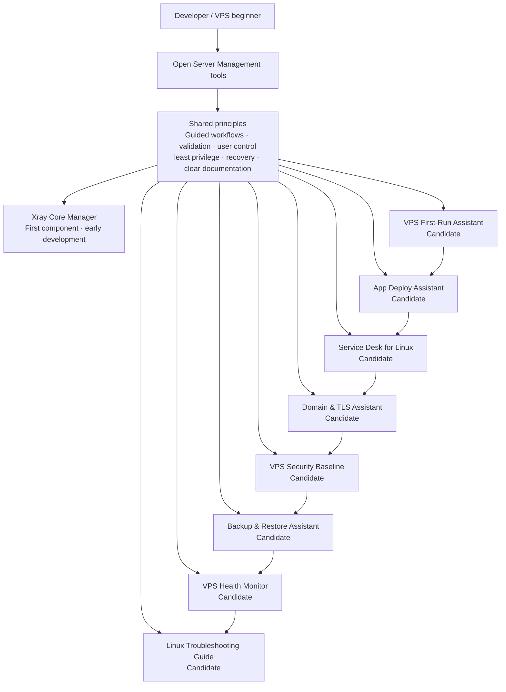

# OSMT Ecosystem Map

The diagram shows the intended relationship between the initiative's shared principles and candidate tools. It is a product vision, not a diagram of currently released software.

## How to read this map

- **Xray Core Manager** is the first implementation in the repository.
- All other boxes are candidate tools for future development.
- Shared principles are intended to create a consistent experience across independent utilities.
- The sequence represents a possible learning and operations journey, not a required dependency chain.
- Each tool should remain useful on its own and clearly document its supported platforms and limitations.
