# OSMT Ecosystem Map

This map presents the **intended structure and direction** of Open Server Management Tools (OSMT): an independent, early-stage open-source initiative for making Linux VPS administration more understandable, safer, and easier to repeat.

It distinguishes the initiative's shared foundation, its first implementation, and proposed future tool families. It is a product vision—not a representation of a completed platform or a claim that every component is available.

## Ecosystem overview

```mermaid
flowchart TB
    PEOPLE["People operating Linux VPS environments"]
    MISSION["OSMT · Open Server Management Tools<br/>Learn · Deploy · Secure · Operate"]
    PURPOSE["Mission<br/>Make server operations understandable,<br/>safer to perform, and repeatable"]

    PEOPLE --> MISSION
    MISSION --> PURPOSE

    PURPOSE --> FOUNDATION["Shared product foundation<br/>Guided Automation"]

    FOUNDATION --> INSPECT["Inspect before changing"]
    FOUNDATION --> EXPLAIN["Explain tasks, impact, and prerequisites"]
    FOUNDATION --> APPROVE["Keep the administrator in control"]
    FOUNDATION --> VALIDATE["Validate and verify"]
    FOUNDATION --> RECOVER["Prepare recovery where practical"]
    FOUNDATION --> TRANSPARENCY["Document limitations and evidence"]

    FOUNDATION --> FIRST["First implementation"]
    FIRST --> XRAY["Xray Core Manager<br/>Early development · 0.2.0-dev"]

    FOUNDATION --> FUTURE["Proposed tool families"]
    FUTURE --> SERVER["Server foundations<br/>VPS First-Run Assistant"]
    FUTURE --> DEPLOY["Application deployment<br/>App Deploy Assistant"]
    FUTURE --> SERVICES["Service operations<br/>Service Desk for Linux"]
    FUTURE --> NETWORK["Networking and domains<br/>Domain & TLS Assistant"]
    FUTURE --> SECURITY["Security review<br/>VPS Security Baseline"]
    FUTURE --> BACKUP["Backup and recovery<br/>Backup & Restore Assistant"]
    FUTURE --> MONITOR["Monitoring and maintenance<br/>VPS Health Monitor"]
    FUTURE --> LEARNING["Learning and diagnostics<br/>Linux Troubleshooting Guide"]

    classDef initiative fill:#17324d,color:#ffffff,stroke:#17324d
    classDef foundation fill:#e8f0f7,color:#172b3a,stroke:#7895ad
    classDef current fill:#e8f3e9,color:#173b24,stroke:#6b9b75
    classDef proposal fill:#f2f2f2,color:#333333,stroke:#999999
    class MISSION,PURPOSE initiative
    class FOUNDATION,INSPECT,EXPLAIN,APPROVE,VALIDATE,RECOVER,TRANSPARENCY foundation
    class FIRST,XRAY current
    class FUTURE,SERVER,DEPLOY,SERVICES,NETWORK,SECURITY,BACKUP,MONITOR,LEARNING proposal
```

## 1. The people and the mission

OSMT is intended for students, junior developers, self-taught developers, independent builders, small teams, and administrators who value focused and inspectable utilities.

The initiative addresses the operational learning curve that often appears when deploying and maintaining applications on Linux VPS environments.

Its mission is expressed through four connected goals:

- **Learn:** understand server components and operational decisions.
- **Deploy:** follow clear and repeatable application deployment procedures.
- **Secure:** identify common risks and understand possible mitigations.
- **Operate:** inspect, maintain, troubleshoot, and recover services.

## 2. Shared foundation: Guided Automation

Guided Automation is the common product philosophy—not a separate application or a feature that is already fully implemented across the ecosystem.

Where relevant, each tool should guide the user through a process that explains the task, inspects the current state, previews proposed changes, validates inputs, requests approval for consequential actions, prepares recovery where practical, applies changes in controlled stages, and reports what could be verified.

The administrator remains responsible for approving system changes. Tools should make the process clearer, not obscure it.

## 3. First implementation: Xray Core Manager

Xray Core Manager is the first component being developed within OSMT.

It currently provides a modular Bash-based foundation for Xray-core administration, including a menu, connection and VLESS draft records, a version-specific adapter, controlled binary/geodata administration, atomic local persistence, locking, backup and guarded uninstallation workflows, and test scripts.

It remains an early-development project. It does not currently apply draft configurations to a running Xray instance, manage the systemd lifecycle, or modify firewall, SSH, or general network settings. Its documented limitations remain part of the project's status.

See the [root README](../README.md) for the current implementation summary and operational boundaries.

## 4. Proposed tool families

The following components are **ideas for future development**, not released products:

| Tool family | Candidate tool | Intended purpose |
|---|---|---|
| Server foundations | VPS First-Run Assistant | Read-only inventory and an understandable first look at a VPS |
| Application deployment | App Deploy Assistant | Guide a bounded, documented application deployment |
| Service operations | Service Desk for Linux | Explain service status, logs, and supported lifecycle actions |
| Networking and domains | Domain & TLS Assistant | Help diagnose DNS, reverse-proxy, and certificate configuration |
| Security review | VPS Security Baseline | Present evidence-based reviews of common server risks |
| Backup and recovery | Backup & Restore Assistant | Help verify backups and rehearse recovery |
| Monitoring and maintenance | VPS Health Monitor | Summarize resource and selected service health |
| Learning and diagnostics | Linux Troubleshooting Guide | Explain errors and guide users through diagnostic steps |

The order in the diagram is not a technical dependency chain. Each candidate should have a clear use case, bounded scope, tests, documentation, and a maintenance plan before being treated as an implementation.

## 5. How the ecosystem may grow

The intended progression is deliberately incremental:

1. Mature Xray Core Manager and document its supported workflows.
2. Establish consistent contribution, testing, security, and release practices.
3. Build a small, read-only VPS First-Run Assistant.
4. Validate it in isolated environments and use feedback to shape subsequent tools.
5. Expand into deployment, service operations, networking, security, backups, monitoring, and diagnostics as each area can be maintained responsibly.

OSMT is technology-neutral. Future tools may use different languages, architectures, or deployment models where those choices best fit their purpose.

## 6. What this map does—and does not—claim

**It does communicate:**
- A shared mission and product philosophy.
- The position of Xray Core Manager as the first implementation.
- The intended areas of future development.
- A possible progression for building a coherent collection of focused tools.

**It does not claim:**
- That all proposed tools already exist.
- That the ecosystem is a single integrated platform today.
- That candidate tools depend technically on one another.
- That Xray Core Manager is production-ready.
- That the project has an established user base or production adoption record.

The map should evolve only when implementation status and project direction change.

---

**One mission. Focused tools. Transparent operations.**
